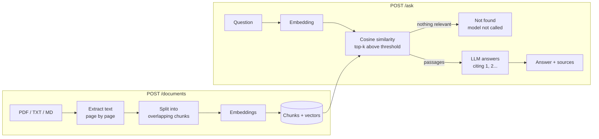

# RAG Docs API


Upload PDF or text documents, then ask questions in plain language. The API finds the relevant passages and answers **with citations** (file and page), using retrieval-augmented generation (RAG).

When nothing relevant is found, it says so instead of letting the model guess.

## How it works



**Ingestion**
1. Text is extracted page by page (`pypdf`), so every passage keeps its page number.
2. Each page is split into ~800-character chunks that end on word boundaries and overlap by ~150 characters, so a sentence cut in two still appears whole in one chunk. Chunks never span two pages.
3. Chunks are embedded in batches and stored with their vectors.

**Question**
1. The question is embedded with the same model.
2. Chunks are ranked by cosine similarity (NumPy). Only the top-k above a minimum score are kept.
3. If none pass the threshold, the API answers "not found" **without calling the model**: no cost, no hallucination.
4. Otherwise the model gets the numbered passages, must cite them (`[1]`, `[2]`) and must not use outside knowledge.

## Features

- Async FastAPI + SQLAlchemy 2.0 (PostgreSQL in Docker, SQLite locally)
- PDF, `.txt` and `.md` uploads, with size limit, type checks and safe filenames
- Answers with sources: file, page, similarity score and excerpt
- Search can be limited to specific documents
- Works with any **OpenAI-compatible** API, including a free local **Ollama** setup
- An offline `fake` provider (keyword embeddings + extractive answers) so it runs and is tested with no API key
- Vectors from different embedding models are never mixed
- 29 tests, Ruff lint, GitHub Actions CI, Docker image running as non-root

## Quick start

**With Docker** (API + PostgreSQL):

```bash
cp .env.example .env
docker compose up --build
```

**Without Docker:**

```bash
python -m venv .venv && source .venv/bin/activate
pip install -e ".[dev]"
uvicorn app.main:app --reload
```

Interactive docs: http://localhost:8000/docs

## Try it

```bash
curl -F "file=@samples/employee-handbook.pdf" localhost:8000/documents
# {"id": "b76d3b78-...", "filename": "employee-handbook.pdf", "pages": 5, "chunks": 5, ...}

curl -X POST localhost:8000/ask \
  -H "Content-Type: application/json" \
  -d '{"question": "How long is the notice period after the first year?"}'
```

```json
{
  "answer": "After the first year, the notice period is two months [1].",
  "found": true,
  "sources": [
    {
      "filename": "employee-handbook.pdf",
      "page": 4,
      "score": 0.56,
      "excerpt": "Notice period. The notice period is one month during the first year of employment and two months after that..."
    }
  ]
}
```

An unrelated question returns `{"found": false, "answer": "I could not find the answer in the documents.", "sources": []}`.

> With the default `fake` provider the answer is the most relevant passage quoted as-is. Switch to a real model (below) to get written answers like the one above.

## Use a real model

**OpenAI** (or any compatible provider) in `.env`:

```bash
LLM_PROVIDER=openai
LLM_API_KEY=sk-...
CHAT_MODEL=gpt-4o-mini
EMBEDDING_MODEL=text-embedding-3-small
```

**Free and local with Ollama:**

```bash
ollama pull llama3.1 && ollama pull nomic-embed-text
```

```bash
LLM_PROVIDER=openai
LLM_BASE_URL=http://localhost:11434/v1
LLM_API_KEY=ollama
CHAT_MODEL=llama3.1
EMBEDDING_MODEL=nomic-embed-text
```

After changing the embedding model, upload your documents again: vectors from different models are not comparable, so older documents are skipped by the search. `MIN_SCORE` may need tuning for each embedding model.

## API

| Method | Path | Description |
|---|---|---|
| `POST` | `/documents` | Upload and index a file (multipart field `file`) |
| `GET` | `/documents` | List indexed documents |
| `DELETE` | `/documents/{id}` | Delete a document and its chunks |
| `POST` | `/ask` | `{"question": "...", "top_k": 4, "document_ids": [...]}` |
| `GET` | `/health` | Health check |

Errors: `415` unsupported file type, `422` no extractable text (e.g. scanned PDF), `413` file too large, `502` model provider error.

## Project structure

```
app/
├── main.py              # app factory and lifespan
├── api.py               # HTTP routes and error mapping
├── config.py            # settings from environment variables
├── models.py            # Document and Chunk tables
├── schemas.py           # Pydantic request/response models
└── services/
    ├── extract.py       # PDF / text extraction, page by page
    ├── chunking.py      # overlapping chunks on word boundaries
    ├── embeddings.py    # hashing (offline) + OpenAI-compatible embedders
    ├── chat.py          # extractive (offline) + OpenAI-compatible chat
    ├── openai_http.py   # shared HTTP client and error handling
    ├── search.py        # cosine similarity with NumPy
    └── rag.py           # ingest and ask workflows
samples/employee-handbook.pdf
tests/
```

## Tests

```bash
pytest -v
ruff check . && ruff format --check .
```

Tests build their PDFs in memory and mock the model provider with `httpx.MockTransport`: no network, no API key.

## Next steps

- Store vectors in PostgreSQL with **pgvector** and an HNSW index for large volumes
- Hybrid search (keywords + vectors) and re-ranking
- OCR for scanned PDFs
- Background ingestion for large files
- An evaluation set of questions/answers to measure retrieval quality
